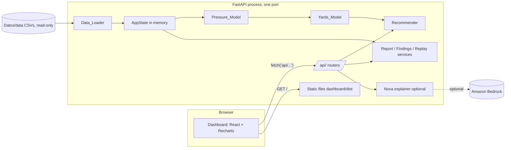

# Design Document

## Overview

The Coach Pass Rush Assistant is a single-process web application. A FastAPI backend (`backend/main.py`, module-level `app`) loads four Big Data Bowl CSV files into memory at startup, builds a play-level dataset (one row per Pass_Play), fits two linear regressions using only numpy and pandas, and serves JSON under `/api/`. The same process serves the built React dashboard from `dashboard/dist` on the same port.

Key design decisions:

- **Everything in memory, read-only.** CSVs are read once with `pandas.read_csv`. No file is written. Derived state lives in one immutable `AppState` object created at startup and stored on `app.state`.
- **Two chained OLS models.** `PressureModel` predicts the pressure label; `YardsModel` takes the clipped pressure probability as an input feature. Both use `numpy.linalg.lstsq` on a one-hot design matrix and share one deterministic 80/20 split (`numpy.random.default_rng(SEED)`).
- **Pure functions at the core.** Cleaning, dataset building, feature encoding, prediction, ranking, aggregation, and all dashboard formatting and navigation logic are pure functions. This keeps them property-testable. FastAPI routes and React components are thin wrappers.
- **Best_Call definition.** Best_Call is the Candidate_Call with the highest predicted pressure probability. Ties are broken by the lowest predicted expected yards (Requirement 5.3). Candidate calls are therefore ranked by `(-pressure, yards)`.
- **Down range.** Valid down is the integer range 0 to 4 everywhere. Down 0 is a two-point conversion.
- **Fail-safe startup.** If required files are missing or malformed, startup raises `StartupError` (non-zero exit) and a fallback ASGI app is exposed so `/api/` requests return an error listing the missing files (Req 1.3, 1.4).

Languages: Python 3.12 (pandas 2.2.3, numpy 2.1.3, FastAPI) for the backend; TypeScript, React, Vite, Recharts, Tailwind CSS 3 for the dashboard.

## Architecture



### Startup sequence

1. `config.resolve_data_dir(env_value, project_root)` returns the Data_Directory (Req 1.2).
2. `loader.check_files(data_dir)` lists missing files; if any, raise `StartupError` naming all of them (1.3).
3. `loader.read_all(data_dir)` reads each CSV completely; empty, unreadable, or header-less files raise `StartupError(file, category)` (1.5). Tracking files are never opened (1.7).
4. `cleaning.clean_plays` and `dataset.build_play_dataset` produce the play-level frame (Req 2).
5. `split.split_indices(n, seed)` yields train and held-out indices.
6. Pressure_Model and Yards_Model are fitted (fit failures are recorded as `unavailable`, not fatal for other endpoints).
7. Candidate_Call table, findings, and per-team aggregates are precomputed.
8. The app reports ready (target under 60 s, model fit under 30 s).

### Project layout (additions only; existing folders untouched)

```
backend/
  main.py            # app = FastAPI(); routes under /api, /health, static mount
  config.py          # resolve_data_dir, env access
  loader.py          # check_files, read_all, StartupError
  cleaning.py        # clean_plays, impute helpers
  dataset.py         # build_play_dataset, pressure label
  linreg.py          # one-hot encoding, OLS fit/predict, metrics
  models.py          # PressureModel, YardsModel
  recommender.py     # candidates, ranking, typical call, flags
  reports.py         # opponent report, findings, replay list
  nova.py            # optional Bedrock explanation
  schemas.py         # Pydantic request/response models
dashboard/src/
  api.ts             # fetchJson with timeout and relative URLs
  lib/validate.ts    # what-if validation
  lib/format.ts      # percent, yards, N/A, quarter/down labels
  lib/replay.ts      # navigation reducer, cumulative comparison
  views/             # WhatIf, Replay, OpponentReport, Findings
```

## Components and Interfaces

### Backend (Python)

```python
# config.py
DEFAULT_DATA_DIR = "Datos/data"
def resolve_data_dir(env_value: str | None, project_root: Path) -> Path:
    """Non-empty env value -> project_root / env_value; otherwise project_root / DEFAULT_DATA_DIR."""

# loader.py
REQUIRED_FILES = ("plays.csv", "pffScoutingData.csv", "players.csv", "games.csv")
class StartupError(Exception):
    missing: list[str]; file: str | None; category: str | None  # unreadable|empty|malformed
def check_files(data_dir: Path) -> list[str]: ...           # names of missing files
def read_all(data_dir: Path) -> dict[str, pd.DataFrame]: ... # read-only

# cleaning.py
def clean_plays(plays: pd.DataFrame, train_median_box: float) -> pd.DataFrame:
    """down 0 and quarter 5 kept unchanged (with is_two_point / is_overtime labels);
    null dropBackType/offenseFormation -> 'Unknown'; null defendersInBox -> train_median_box."""
def train_median_defenders_in_box(plays: pd.DataFrame, train_idx: np.ndarray) -> float: ...

# dataset.py
def build_play_dataset(plays: pd.DataFrame, scouting: pd.DataFrame) -> pd.DataFrame:
    """Join on (gameId, playId). One row per Pass_Play. pressure in {0,1}.
    Raises DataError(column_or_file) if a needed column is absent; never returns partial output."""

# linreg.py
def split_indices(n: int, seed: int, train_frac: float = 0.8) -> tuple[np.ndarray, np.ndarray]: ...
def fit_ols(X: np.ndarray, y: np.ndarray) -> np.ndarray: ...   # lstsq
def metrics(y_true, y_pred) -> dict:  # {"r2": float, "mae": float}

# models.py
@dataclass(frozen=True)
class Situation:
    down: int; yards_to_go: int; offense_formation: str; expected_coverage: str
    pass_rushers: int | None = None; defenders_in_box: int | None = None
class PressureModel:
    def predict(self, s: Situation) -> float: ...   # clipped to [0, 1]
    def metrics(self) -> dict: ...                  # r2, mae, n_train, n_heldout
class YardsModel:
    pressure_coef: float
    def predict_raw(self, s: Situation, pressure: float) -> float: ...
    def predict(self, s: Situation) -> float: ...   # round(..., 2), uses PressureModel
    def metrics(self) -> dict: ...                  # r2, mae_yards
def validate_situation(s, vocab) -> list[str]: ...  # names of invalid fields

# recommender.py
@dataclass(frozen=True)
class CandidateCall: coverage: str; pass_rushers: int; defenders_in_box: int
def candidate_calls(train: pd.DataFrame) -> list[CandidateCall]: ...   # distinct observed
def rank_calls(scored: list[ScoredCall]) -> list[ScoredCall]: ...      # sort by (-pressure, yards)
def recommend(state: AppState, s: Situation) -> Recommendation: ...
```

`Recommendation` fields: `best_call`, `ranked` (list with `call`, `pressure_probability` in 0..1, `expected_yards` rounded to 1 decimal), `typical_call`, `yards_delta_vs_typical` (1 decimal), `two_point_conversion` (down == 0), `low_confidence` (matches < 30), `recommendation_id`.

For each Candidate_Call the recommender evaluates the Pressure_Model with the call's coverage, pass rushers, and defendersInBox, then feeds that probability to the Yards_Model. The typical call is the Candidate_Call with the highest play count among training plays matching the situation (same down, yards-to-go, formation, expected coverage); the match count drives `low_confidence`.

Because the Yards_Model uses expected coverage but candidates vary the defensive coverage, the situation's expected coverage is fixed per request and the candidate's coverage feeds only the Pressure_Model feature set.

### HTTP API (all under `/api/`, plus `/health` and static root)

| Method and path | Purpose | Requirement |
|---|---|---|
| GET `/health` | `{"status": "ok"}` | 1.9 |
| GET `/api/vocab` | distinct formations, coverages | 6.5 |
| POST `/api/recommend` | Situation in, Recommendation out; 422 on invalid input | 5, 6.4 |
| GET `/api/metrics` | Pressure and Yards model fit metrics | 3.4, 4.5 |
| GET `/api/games` | games sorted by date ascending | 7.1 |
| GET `/api/games/{gameId}/plays` | ordered Pass_Plays with best call, actual call, outcome | 7.2, 7.3 |
| GET `/api/teams` | team list | 8 |
| GET `/api/teams/{team}/report` | Opponent_Report | 8 |
| GET `/api/findings` | summary values, group breakdowns, rankings | 9 |
| POST `/api/recommendations/{id}/explain` | optional Nova explanation | 11 |

Error mapping: invalid Situation returns 422 naming each invalid field; model unavailable returns 503 with `"unavailable"`; unknown recommendation returns 404; Bedrock failure or missing env returns 503 with "explanation unavailable". Startup failure serves an ASGI fallback that returns 503 listing missing files for any `/api/` path.

### Static serving

`app.mount("/", StaticFiles(directory="dashboard/dist", html=True))` is registered last so API routes win. Vite `base` is `'./'`.

### Dashboard (TypeScript)

```ts
// api.ts - relative URLs only, 10 s timeout via AbortController
export async function getJson<T>(path: string): Promise<T>   // fetch(`api/${path}`)

// lib/validate.ts
export interface WhatIfInput { down: string; yardsToGo: string; formation: string; coverage: string }
export function validateWhatIf(i: WhatIfInput): string[]      // messages naming each invalid field

// lib/format.ts
export const formatPercent = (p: number) => string            // "37.6%"
export const formatYards = (y: number) => string              // one decimal
export const formatOrNA = (num: number, den: number, unit: '%' | 'yards') => string
export const quarterLabel = (q: number) => string             // 5 -> "overtime"
export const downLabel = (d: number) => string                // 0 -> "two-point conversion"

// lib/replay.ts
export interface NavState { index: number; total: number }
export type NavAction = {type:'next'} | {type:'prev'} | {type:'jump', position:number}
export function navReduce(s: NavState, a: NavAction): NavState
export const canPrev = (s: NavState) => boolean
export const canNext = (s: NavState) => boolean
export function cumulative(plays: ReplayPlay[], upTo: number): { actual: number; predicted: number; diff: number }
```

Views: `WhatIfView`, `ReplayView`, `OpponentReportView` (Recharts bar charts comparing team versus league average), `FindingsView` (five summary values, three group charts, two rankings). Each view owns its own loading, error, and retry state so one failure leaves the others usable (Req 10.8, 10.9). The What-If view marks a shown result outdated within 500 ms of any input change and keeps it visible until a new result arrives (6.6).

## Data Models

### Play-level dataset (one row per Pass_Play)

| Column | Type | Notes |
|---|---|---|
| gameId, playId | int | composite key, unique |
| quarter | int | 5 means overtime, unchanged |
| down | int | 0 to 4, 0 means two-point conversion, unchanged |
| yardsToGo | int | 0 to 99 |
| offenseFormation | str | null becomes `Unknown` |
| dropBackType | str | null becomes `Unknown` |
| expectedCoverage | str | categorical |
| actualCoverage, passRushers, defendersInBox | str/int | defendersInBox null becomes training median |
| pressure | int 0 or 1 | 1 if any hit, hurry, or sack is nonzero among scouting rows |
| sack | int 0 or 1 | used for sack rates |
| yardsGained | float | target of Yards_Model |
| possessionTeam, defensiveTeam, gameClock | str | for reports and replay ordering |

Blocking metrics use only `pff_role == "Pass Block"` rows, rushing metrics only `"Pass Rush"` rows. Role strings are matched case-sensitively. Nulls in fields that apply only to another role are not counted as missing and are not imputed.

### Model design

- Pressure_Model features: down (numeric), yardsToGo, one-hot offenseFormation, one-hot expectedCoverage, passRushers, defendersInBox, plus intercept.
- Yards_Model features: pressure probability (clipped, 0 to 1), down, yardsToGo, one-hot offenseFormation, one-hot expectedCoverage, plus intercept.
- Fit: `beta = np.linalg.lstsq(X, y, rcond=None)[0]`. The vocabulary (category lists) is stored from the training split, and values not in it are rejected at validation time.
- Split: one permutation from `np.random.default_rng(SEED)`, first 80% train, rest held-out.
- Metrics on held-out: `r2 = 1 - SS_res/SS_tot`, `mae = mean(|y - yhat|)`, with `n_train` and `n_heldout`.
- Training the Yards_Model uses the Pressure_Model's clipped prediction as the feature, so the chain used for training matches the chain used at inference.

### AppState

```python
@dataclass(frozen=True)
class AppState:
    plays: pd.DataFrame; players: pd.DataFrame; games: pd.DataFrame
    dataset: pd.DataFrame; train_idx: np.ndarray; heldout_idx: np.ndarray
    pressure_model: PressureModel | None; yards_model: YardsModel | None
    vocab: dict[str, list[str]]; candidates: list[CandidateCall]
    findings: dict; team_stats: dict; league_avg: dict
    recommendations: dict[str, Recommendation]   # in-memory store for explain
```

### Opponent_Report

Per team, offense and defense separately: `pass_plays` (int), `pressure_rate` (3 dp), `sack_rate` (3 dp), `avg_yards` (2 dp). Plus pressure rate and average yards by coverage and by formation (each group with `count`), top-5 sackers and top-5 pressure players sorted by count descending then name ascending, with `name` and `position` from players.csv (`playerId` and `"unknown"` when missing). Players with zero are not listed. A team with no Pass_Plays returns an empty report with a "no data" message.

### Findings

Five values computed at startup: overall pressure rate, average yards with pressure, average yards without pressure, sack rate with pressure, sack rate without pressure. A value with a zero denominator is `null` and rendered as "N/A". Group tables by coverage, formation, and defendersInBox (pressure rate and average yards per group); top 10 players by sacks; top 10 teams by pressure rate.

## Error Handling

| Condition | Behavior |
|---|---|
| Missing CSV(s) | Abort with non-zero exit, message lists every missing file; fallback app returns 503 listing them for `/api/` (1.3, 1.4) |
| Unreadable, empty, or headerless CSV | Abort with file name and category (1.5) |
| Missing join or label column | `DataError` naming the file or column; no dataset produced, previous output untouched (2.10) |
| Fewer than 100 labeled plays or fit failure | Startup log records failure; model endpoints return 503 "model unavailable" (3.7, 4.6) |
| Invalid Situation (missing, out of range, unseen category, down not in 0..4, yardsToGo not in 0..99) | HTTP 422 naming each invalid field; no prediction; model unchanged (3.6, 4.4, 5.7, 6.4) |
| Prediction cannot be produced | Error response "prediction unavailable" within 2 s, no Best_Call (5.7) |
| Down equals 0 | Recommendation returned with `two_point_conversion = true` (5.5) |
| Fewer than 30 matching plays | `low_confidence = true`, ranking still returned (5.6) |
| Unknown team | Empty report with message (8.8); computation failure returns an error "report could not be generated" (8.9) |
| Unknown recommendation id on explain | 404, Bedrock not invoked (11.6) |
| Missing `AWS_REGION` or `BEDROCK_MODEL_ID`, Bedrock error, or 10 s timeout | 503 "explanation unavailable", other endpoints unaffected, stored recommendation unchanged (11.3, 11.7) |
| Dashboard request fails, times out (10 s), or returns non-success | View-local error message, retry control, entered values retained, other views usable (6.7, 7.11, 9.6, 10.9) |
| Dashboard validation failure | Message naming each invalid field, no request sent, values retained (6.3) |

Nova client rules: `boto3.client("bedrock-runtime", region_name=os.environ["AWS_REGION"])` only; model from `BEDROCK_MODEL_ID`; credentials are never read, verified, or logged. Explanations are truncated to at most 1,000 characters. No core endpoint calls `nova.py`.

## Correctness Properties

*A property is a characteristic or behavior that should hold true across all valid executions of a system-essentially, a formal statement about what the system should do. Properties serve as the bridge between human-readable specifications and machine-verifiable correctness guarantees.*

### Property 1: Data directory resolution

For any environment value (None, empty, or non-empty path) and any project root, `resolve_data_dir` returns the root joined with the value when it is non-empty, and the root joined with `Datos/data` otherwise.

**Validates: Requirements 1.2**

### Property 2: Missing files are all reported

For any subset of the four required CSV files present in a directory, `check_files` returns exactly the names of the absent files, and startup fails with an error naming every one of them when that set is non-empty.

**Validates: Requirements 1.3, 1.4**

### Property 3: Cleaning preserves labels and removes nulls

For any plays frame, after cleaning, every `down` and `quarter` value equals its input value (0 and 5 included), the two-point and overtime labels are set exactly where down is 0 and quarter is 5, no nulls remain in `dropBackType`, `offenseFormation`, or `defendersInBox`, null categoricals become `Unknown`, and null `defendersInBox` values equal the median of non-null `defendersInBox` values of the training rows only.

**Validates: Requirements 2.1, 2.2, 2.3, 2.4**

### Property 4: Role-specific metrics and composite-key join

For any plays and scouting frames (including playIds that repeat across games and rows with arbitrary role strings), blocking metrics depend only on rows with role exactly `Pass Block`, rushing metrics depend only on rows with role exactly `Pass Rush`, and each play's metrics equal those computed from the rows with the same `(gameId, playId)` pair only.

**Validates: Requirements 2.5, 2.6, 2.7, 2.8**

### Property 5: One labeled row per Pass_Play

For any plays and scouting frames, the play-level dataset has exactly one row per distinct `(gameId, playId)` that has at least one `Pass Rush` or `Pass Block` row, the pressure label is 1 exactly when some scouting row of that play has a nonzero hit, hurry, or sack value and 0 otherwise, and yards gained is numeric.

**Validates: Requirements 2.9, 8.10**

### Property 6: Missing columns fail without partial output

For any required column removed from the inputs, `build_play_dataset` raises an error naming that column or its file and returns no dataset.

**Validates: Requirements 2.10**

### Property 7: Deterministic, shared 80/20 split

For any dataset size n at or above 100 and any seed, `split_indices` called twice returns identical train and held-out indices, the two sets are disjoint and together cover all n rows, and the train size is `floor(0.8 n)` (within one row of rounding); both models use these same indices.

**Validates: Requirements 3.5, 4.1**

### Property 8: Model outputs are bounded and rounded

For any valid Play_Situation, the Pressure_Model returns a value in [0, 1], the Yards_Model returns a value with at most 2 decimal places, and every Candidate_Call result in a recommendation has pressure in [0, 1] and expected yards with at most 1 decimal place.

**Validates: Requirements 3.3, 4.3, 5.2**

### Property 9: Reported metrics match held-out recomputation

For any fitted pair of models, the reported R-squared, mean absolute error, and train and held-out row counts equal values recomputed independently from the held-out split, and the row counts sum to the dataset size.

**Validates: Requirements 3.4, 4.5**

### Property 10: Invalid situations are rejected and leave models unchanged

For any valid Play_Situation with one field replaced by an invalid value (missing, down outside 0 to 4, yards to go outside 0 to 99, or a formation or coverage unseen in training), validation rejects it with a message naming that field, no prediction is computed, and the fitted coefficients are unchanged afterward.

**Validates: Requirements 3.6, 4.4, 5.7, 6.4**

### Property 11: Yards respond linearly to pressure

For any valid Play_Situation and any two pressure values p1 and p2, `predict_raw(s, p2) - predict_raw(s, p1)` equals `pressure_coef * (p2 - p1)` within 0.01 yards.

**Validates: Requirements 4.2, 4.7**

### Property 12: Ranking order and Best_Call

For any valid Play_Situation, the ranked list contains every Candidate_Call observed in training exactly once, is ordered by pressure probability descending with ties ordered by expected yards ascending, and Best_Call equals its first element.

**Validates: Requirements 5.1, 5.3**

### Property 13: Typical call and yards delta

For any valid Play_Situation with at least one matching training play, the typical call is the Candidate_Call with the highest play count among matching training plays, and the reported delta equals the Best_Call expected yards minus the typical call expected yards, rounded to one decimal place.

**Validates: Requirements 5.4**

### Property 14: Situation flags

For any valid Play_Situation, `two_point_conversion` is true exactly when down is 0, and `low_confidence` is true exactly when fewer than 30 training plays match the situation; the ranked list is returned in both cases.

**Validates: Requirements 5.5, 5.6**

### Property 15: What-If client validation

For any combination of down, yards to go, formation, and coverage input strings, `validateWhatIf` returns no messages exactly when down is an integer in 0 to 4, yards to go is an integer in 0 to 99, and formation and coverage are non-empty; otherwise it returns one message naming each invalid field.

**Validates: Requirements 6.3**

### Property 16: Games sorted by date

For any games frame, the games endpoint returns every game with date, home team, and visitor team, ordered by date ascending.

**Validates: Requirements 7.1**

### Property 17: Replay play ordering

For any set of Pass_Plays of a game, the replay list is ordered by quarter ascending and then by game clock descending within each quarter, and contains each Pass_Play exactly once.

**Validates: Requirements 7.2**

### Property 18: Replay labels

For any play, `quarterLabel` returns "overtime" when the quarter is 5 and the numeric quarter otherwise, and `downLabel` returns "two-point conversion" when down is 0 and the numeric down otherwise.

**Validates: Requirements 7.4, 7.5**

### Property 19: Navigation bounds

For any total number of plays and any sequence of next, prev, and jump actions, the index always stays within 1 to total (or the state is empty when total is 0), `canPrev` is false exactly at position 1 or when empty, `canNext` is false exactly at the last position or when empty, and a jump to a position in 1..total lands on that position.

**Validates: Requirements 7.6, 7.7, 7.8, 7.9**

### Property 20: Cumulative comparison

For any list of replay plays and any position k, the cumulative actual yards equal the sum of actual yards of plays 1..k, the cumulative predicted yards equal the sum of Best_Call predicted yards of plays 1..k, and the difference equals the first sum minus the second, rounded to one decimal place.

**Validates: Requirements 7.10**

### Property 21: Opponent report aggregates

For any plays dataset and any team with at least one Pass_Play, the report's offense and defense play counts, pressure rates (3 dp, in 0..1), sack rates (3 dp, in 0..1), and average yards (2 dp) equal independently recomputed values, and the per-coverage and per-formation breakdown counts each sum to the corresponding total.

**Validates: Requirements 8.1, 8.2**

### Property 22: Top player rankings

For any team's player counts, the top-sack and top-pressure lists have at most five entries, include only players with count at least 1, are ordered by count descending then name ascending, are identical across repeated calls, and any player missing from players.csv appears with the identifier as name and position "unknown".

**Validates: Requirements 8.3, 8.4, 8.5, 8.6**

### Property 23: Findings computed from data

For any plays dataset, each of the five summary values equals its independent recomputation from the data, each group table includes every distinct group value present, and the player (top 10 by sacks) and team (top 10 by pressure rate) rankings are sorted descending.

**Validates: Requirements 9.2, 9.4, 9.5**

### Property 24: Safe numeric formatting

For any numerator and denominator, `formatOrNA` returns "N/A" when the denominator is zero and otherwise a string with one decimal place and the correct unit, and its output never contains "NaN", "Infinity", or an empty string.

**Validates: Requirements 9.1, 9.3**

### Property 25: Explanation length cap

For any text returned by the Optional_AI_Service, the explanation returned by the backend has at most 1,000 characters.

**Validates: Requirements 11.1**

## Testing Strategy

### Dual approach

- **Property tests** cover Properties 1 to 25. Backend: `hypothesis` (dev-only test dependency; confirm it is allowed under the Stack_Contract before adding it, otherwise use seeded `numpy.random` generators looped 100+ times). Dashboard: `fast-check` with Vitest, subject to the same Stack_Contract check. Each property test runs at least 100 iterations and carries the tag `Feature: coach-pass-rush-assistant, Property {n}: {title}`.
- **Unit and example tests** cover specific behaviors:
  - Startup: `/health` body, read-only loading, tracking files never opened, startup abort exit codes (1.1, 1.5 to 1.10).
  - Model failure paths: fewer than 100 labeled plays and injected fit failure produce "model unavailable" (3.7, 4.6).
  - What-If UI: submit disabled until all four inputs are set, result shown in order, outdated mark within 500 ms, error state keeps values and enables retry (6.1, 6.2, 6.5 to 6.7).
  - Replay UI: first play shown after selection, step display fields, empty game message, error and retry (7.3, 7.9, 7.11).
  - Opponent report charts, empty team message, computation failure (8.7 to 8.9).
  - Findings error state (9.6); loading indicators and error views (10.8, 10.9).
  - Nova: mocked Bedrock client; not-found and missing-env cases never call Bedrock; failure and timeout map to "explanation unavailable"; recommendation endpoints never touch Bedrock (11.2 to 11.7).
- **Smoke and compliance checks** (single execution): route enumeration shows only `/api/*`, `/health`, and static root (10.1); grep that dashboard sources contain no URL beginning with `/` or a scheme (10.2); `vite build` exits 0, outputs to `dashboard/dist`, and `base` is `'./'` (10.3); root URL returns the index page and an API route responds on the same port (10.4); dependency file contains only Stack_Contract packages and no ML library (10.5, 10.6); protected folders unchanged (10.7).

### Test data

Property tests build small synthetic frames with the real column names. Collisions of `playId` across games, null categoricals, downs 0 to 4, quarter 5, mixed-case role strings, and non-ASCII player names are included in the generators. A small fixture dataset (about 300 synthetic plays) backs the model and recommender tests so fits finish in milliseconds.
